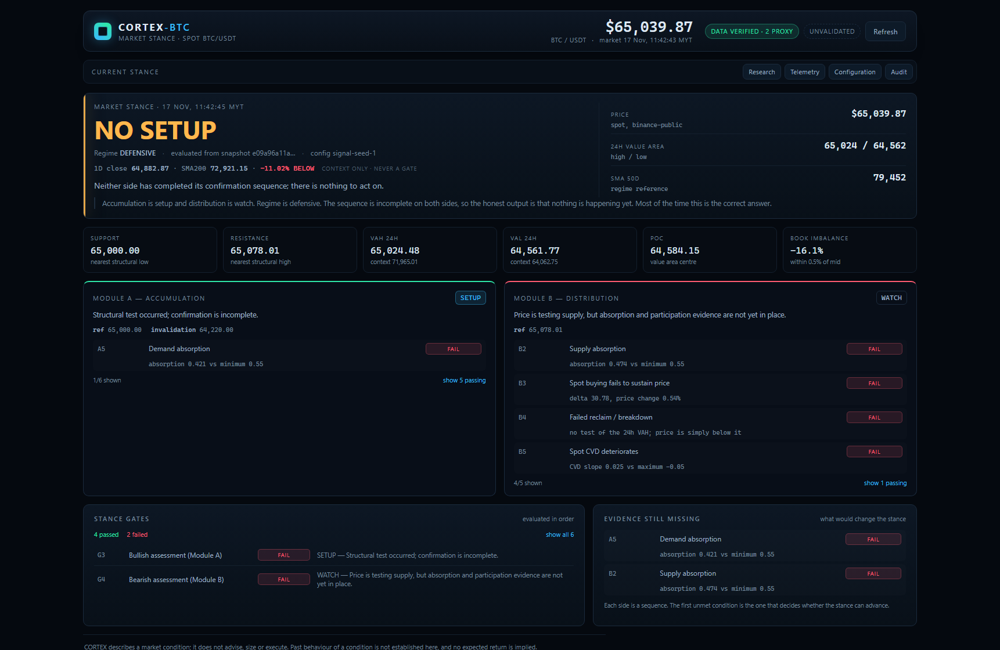
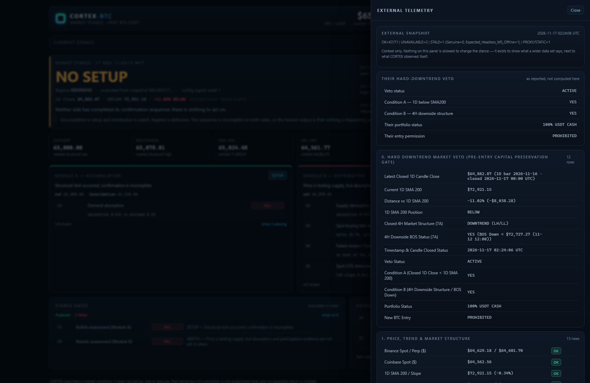
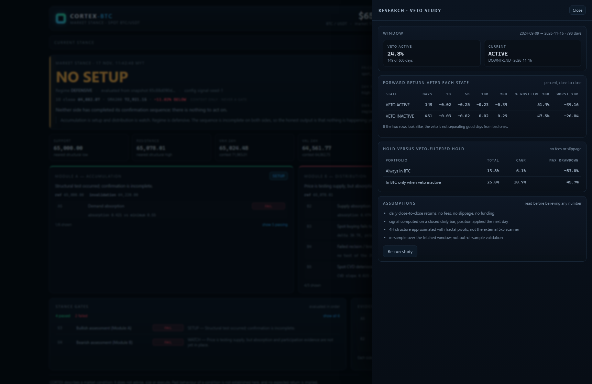

# CORTEX-BTC — Market Stance

A BTC/USDT market-stance dashboard. It answers one question — **what condition is
the market in right now** — with evidence that can be audited and replayed.

It holds no balances, sizes no positions, and issues no instructions. You decide
what to do with the observation.

> **Strategy status: UNVALIDATED.** No claim of profitability or edge is made or
> implied. Every number in the shipped profile is an illustrative research
> starting point, not an optimised parameter.



**This repository is the source, not a live site.** GitHub stores the code; the
dashboard is a Python process you run yourself (see *Quick start* below, then
*Hosting on the local network*).

## What it publishes

| Stance | Meaning |
|---|---|
| **QUALIFIED BUY ZONE** | Selling was absorbed at a verified support and price reclaimed value. |
| **QUALIFIED SELL ZONE** | Buying was absorbed at supply and price failed to hold value — classified as DISTRIBUTION or BREAKDOWN. |
| **NO SETUP** | The confirmation sequence is incomplete on both sides. Usually the correct answer. |
| **CONFLICT** | Both directions produced credible evidence, or one side is unresolved. No stance is forced. |
| **DATA HALT** | A mandatory feed is stale, missing or conflicting. No stance is published. |

## Quick start

Requires Python 3.11+. No third-party runtime packages, no Node, no build step.

```powershell
cd cortex-btc
python -m cortex.server
# http://127.0.0.1:8787
```

Database and configuration default to `data/cortex.db` and
`config/research-seed.json`; override with `CORTEX_DB`, `CORTEX_SEED_CONFIG`
and `CORTEX_PORT`.

## How a stance is produced

```
public market data  →  features with provenance  →  Module A and Module B
                                                          ↓
                                              conflict resolution
                                                          ↓
                                                   one stance
```

Six gates, in order: data integrity → regime → bullish assessment → bearish
assessment → conflict resolution → stance. Every gate is displayed; passing ones
collapse, failing ones stay visible. There is no composite score and no
confidence percentage, because no validated method exists to produce one.

Module A and Module B are **independent evidence readers**, not inversions of each
other. Neither can produce a stance on its own; the synthesis step does.

## Design invariants

1. **The stance is a pure function** of the market snapshot and the configuration.
   No clock, network or randomness inside; timestamps are inputs.
2. **Snapshots are content addressed.** `replay_key` hashes the snapshot and
   config, and is unique in SQLite — reprocessing cannot duplicate a record.
3. **Gates fail closed.** A stale, missing or conflicting mandatory feed forces
   DATA HALT. Nothing is estimated to keep the dashboard alive.
4. **Conditions encode a sequence, not a static inequality.** "Failed reclaim"
   requires price to have tested the boundary and been rejected. Merely trading
   below value is not distribution.
5. **Unconfigured is not zero.** Missing thresholds render NOT CONFIGURED and
   cannot certify a setup.
6. **The value-area horizon is a measurement convention.** The reclaim/breakdown
   test uses a rolling 24-hour profile (`analysis.value_area_hours`); the 168-hour
   profile is context and never gates.

## Data honesty

- Spot price, OHLCV, taker-split delta and depth are observed from Binance's
  public API and marked `VERIFIED`; derived structure (support, value area, SMA)
  carries a `derived:` provenance string.
- Absorption is a **proxy** computed from close location and aggressor volume —
  labelled `PROXY`, and it cannot alone confirm a setup.
- Confirmed liquidation data has no trustworthy free public source here, so it is
  `UNAVAILABLE` and never blocks a stance.
- Futures open interest and funding are contextual only.

## Hosting on the local network

```powershell
.\run.ps1
```

Binds `0.0.0.0:8787` and requires a token, generated on first run into
`data/access-token.txt`. Open from another device on the same network:

```
http://<laptop-ip>:8787/?token=<token>
```

The token is exchanged once for an HttpOnly cookie, so links inside the app work
normally afterwards. Without a token, API calls return 401 and pages show a
token prompt.

**Windows may block inbound connections until you allow them.** If another
device cannot connect, run once as administrator:

```powershell
netsh advfirewall firewall add rule name="CORTEX-BTC 8787" dir=in action=allow protocol=TCP localport=8787 profile=private
```

### Limits of this setup — read before sharing

- **One shared token.** It grants read *and* configuration changes. Treat it as
  an admin credential and share it only with people you would let retune the
  stance. Changes are versioned and attributed to the operator name typed in the
  form, but attribution is self-declared.
- **HTTP, not HTTPS.** Traffic on the LAN is unencrypted, and the token appears
  in the URL the first time. Fine for a home network, not for a café.
- **Never port-forward this port.** It is a LAN appliance, not a public service.
- If the group grows, the next hardening step is splitting a read token from an
  admin token for `POST /api/config`.

## External telemetry (context, never a gate)

A wider Data Hub snapshot can be dropped at `data/telemetry/latest.md`. It is
parsed into labelled rows with their statuses and shown in the Telemetry drawer,
including the external hard-downtrend veto verbatim. **Nothing parsed from it can
change a stance** — the JSON carries `"gating": false`, and the parser lives
outside the decision path. Stale files are flagged.



## Trend context

The header shows the last closed 1D candle against its 200-day SMA. It is
displayed so "no setup" can be read in the context of a hostile or supportive
higher timeframe. It is not a gate; the regime gate still uses the configured
50-day SMA.

## Research: the veto study

`POST /api/research/refresh` (or the button in the Research drawer) replays daily
and 4H history and reports:

- how often the 200D / 4H veto is active;
- forward 1/5/10/20-day returns after veto-active versus veto-inactive days;
- an always-in hold versus a veto-filtered hold, with drawdown.

Assumptions are printed with the result: close-to-close, no fees, signal applied
the next day, approximate 4H pivots, in-sample. Overlapping forward windows mean
the effective sample is far smaller than the day count suggests.



## Layout

```
config/research-seed.json   illustrative, unvalidated profile
cortex/domain.py            enums, snapshots, hashing, Decimal helpers
cortex/config.py            immutable versioned configuration
cortex/modules.py           Module A, Module B, regime classification
cortex/authority.py         six gates, conflict resolution, stance
cortex/market.py            Binance public ingestion + derived features
cortex/telemetry.py         external snapshot parser (context only)
cortex/backtest.py          veto study: forward returns, filtered equity
cortex/research.py          history fetch + study runner
cortex/store.py             SQLite: decisions, config versions, meta
cortex/app.py               orchestration services
cortex/server.py            loopback HTTP API + static dashboard
cortex/web/                 dashboard (vanilla ES modules, no build)
tests/                      27 tests: evidence, gates, governance, parser, study
```

## Tests

```powershell
python -m pytest -q
```

## History

An earlier portfolio version — dual-inventory ledger, allocation controller,
position sizing and order lifecycle — is preserved in git at commit `8b2ee6d`.
This product deliberately scopes that away rather than carrying it as dead code.

## Not in scope, by mandate

Leverage, margin, futures, shorting, borrowed capital, autonomous execution,
personal position sizing, and any claim of a proven edge.
